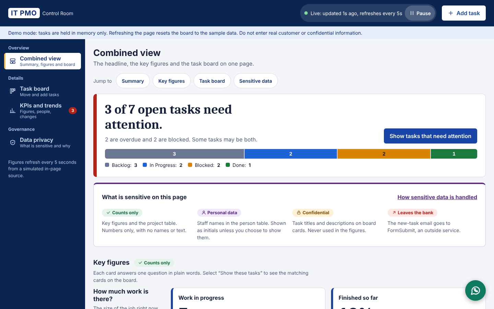

# IT PMO Control Room

A demo control room for the IT Project Management Office of a **fictitious bank**, built as a training tool. It combines plain-language KPIs with a Kanban board. The whole app is one file, `index.html`, written in plain HTML, CSS and JavaScript. It has no build step, no dependencies and no server.

**Live demo:** https://madhubala0703.github.io/ClaudecodeTest/



## Features

- **Combined view:** a plain-language headline ("3 of 7 open tasks need attention"), six KPI cards and the Kanban board on one page.
- **Navigation:** a sidebar (a bottom bar on phones) with Combined view, Task board, KPIs and trends, and Data privacy. Each view has its own link, such as `#kpis`.
- **KPIs for non-technical users:** each card has a plain label, one number, a one-line meaning and a status with an icon and text (never colour alone). "Show these tasks" filters the board to the matching cards.
- **Live refresh every 5 seconds:** figures update from a simulated in-page async source, using parallel requests that never overlap. Updates pause when the tab is hidden or when you click Pause. The board itself is not redrawn by a refresh.
- **Sensitive data considerations:** analytics use counts only, staff names are shown as initials by default, the Add Task form blocks card numbers, national IDs, emails and passwords, and a Data privacy page lists what is handled and what a real deployment would still need.
- Four columns: **Backlog**, **In Progress**, **Blocked** and **Done**. Drag and drop cards, or use the **Move to** menu on each card from the keyboard.
- Add tasks through a validated form. Filter by project, assignee and priority.
- Overdue cards are highlighted. The sample due dates are relative to today, so some cards are always overdue.
- Deleting a card asks for inline confirmation (**Delete? Yes / No**).
- Optional email notice for each new task, sent through [FormSubmit](https://formsubmit.co).
- **Security briefing reminder:** after 10 seconds on the page, a dialog announces the company security briefing next Monday at 10:00 am in the Town Hall room. It shows once per visit. The script is `.claude/hooks/security-briefing.js`, and the details are editable at the top of that file.
- **IT support chat widget:** a floating button at the bottom right opens a list of suggested IT support questions. Choosing one opens WhatsApp (number set in `SUPPORT_WHATSAPP`) with the message ready to send.
- Responsive layout and keyboard accessible.

## Run it locally

- Double-click `index.html` to open it in any modern browser, or
- serve the folder to test the email notice (FormSubmit rejects `file://` pages):

  ```bash
  python3 -m http.server 8000
  # open http://localhost:8000
  ```

## Configuration

The email notice is sent to the address in `FORMSUBMIT_ENDPOINT`, near the top of the script in `index.html`:

```js
const FORMSUBMIT_ENDPOINT = "https://formsubmit.co/ajax/YOUR_EMAIL@example.com";
```

FormSubmit needs a one-time activation. The first submission sends a confirmation link to that address, and nothing is delivered until you click it. If the email fails, the card is still added and a warning is shown.

> Any address you put here becomes public on GitHub and on the live site.

## Notes

- **Nothing is saved, on purpose.** Tasks live only in memory, and refreshing the page resets the board to the sample data.
- The only network request is the optional FormSubmit call. The IT support widget only contains links that open WhatsApp in a new tab when clicked. The 5-second refresh reads from the page's own in-memory data and makes no request.
- New-task emails go to an external service. Do not enter real customer or confidential information.

## Deployment

Every push to `main` deploys `index.html` to GitHub Pages through the workflow in [`.github/workflows/pages.yml`](.github/workflows/pages.yml). Only the site file and the briefing hook script are published, not repo files such as `CLAUDE.md`, `.claude/` or `.agents/`.

## Disclaimer

This is a training demo. The bank, projects, people and tasks are all fictitious, and it is not linked to any real financial institution.

## Project skills

Design and quality guidance for Claude Code lives in `.claude/skills/` (linked to `.agents/skills/`): `frontend-design`, `ui-ux-pro-max`, `cybersecurity-analyst` and `frontend-async-best-practices`. These are third-party skills and keep their own licences. They are not part of the published site.
